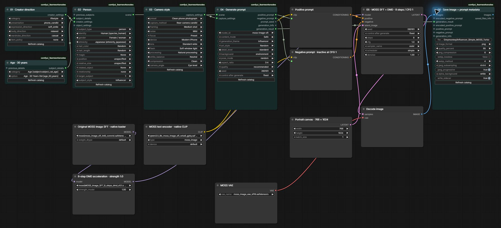
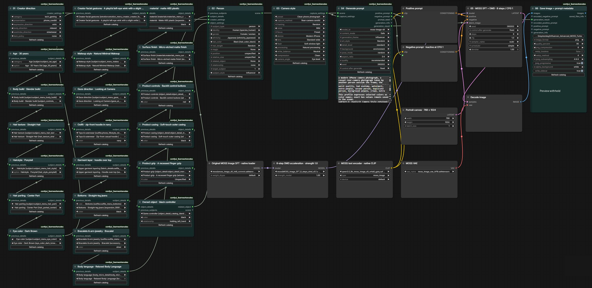

# Greymonkey for ComfyUI

Build model-specific image prompts in ComfyUI with [Greymonkey Prompt Studio](https://greymonkeys.nl).

Configure people, creatures and objects, add owned details and interactions, or generate a compatible random scene. Connect the positive and negative text outputs to your existing image workflow. Greymonkey generates **prompt text**; your image model and sampler still generate the image.

[Website](https://greymonkeys.nl) · [Download ZIP](https://github.com/ThuGie/ComfyUI-Greymonkey/archive/refs/heads/main.zip) · [Report a problem](https://github.com/ThuGie/ComfyUI-Greymonkey/issues)

## Features

- Checkpoint-specific prompt profiles, including Z-Image, Qwen Image, FLUX, Krea, MOSS, Stable Diffusion and specialist anime profiles. Refresh the catalog for the current supported list.
- Positive prompt, separate negative prompt where supported, prompt seed, warnings and structured generation metadata.
- Random scenes or configured subject chains, with up to eight total people, animals and objects.
- Independent identity, gender, ancestry, hair, clothing, expressions, poses, colors and compatible interactions.
- Dedicated object and object-detail nodes for props, vehicles, materials and component colors.
- Optional Influencer Settings for coordinated creator categories, capture presentations and expression/body directions.
- Camera Style presets and refinements for phone snapshots, selfies and other photographic capture descriptions.
- Named workflow settings that preserve selections, with legacy node adapters and explicit upgrade controls.
- PNG, JPEG and WebP saving with prompt/workflow metadata and sidecars.

## Included MOSS influencer workflows

Both workflows use **original MOSS Image SFT + the installed 8-step DMD acceleration adapter**, not a style/model mix. They use native ComfyUI MOSS loaders, 768 × 1024 output, 8 Euler/simple steps and CFG 1. The prompt profile remains MOSS Image SFT because the adapter changes sampling rather than the model family.

### Simple: influencer portrait

[Download the simple workflow](workflows/Greymonkey_Influencer_Simple_MOSS_Turbo.json) · [View full-size screenshot](docs/images/influencer-simple-workflow.png)

A compact 15-node setup: creator direction, one adult person, age detail, camera style, prompt generation, original MOSS model + acceleration, sampling and metadata-aware saving.



### Advanced: owned details and object interaction

[Download the advanced workflow](workflows/Greymonkey_Influencer_Advanced_MOSS_Turbo.json) · [View full-size screenshot](docs/images/influencer-advanced-workflow.png)

A 33-node setup with independent controls for body build, hairstyle, texture, parting, eye color, facial expression, makeup, gaze, layered clothing and body language. A separate controller chain owns its identity, material, finish, casing, grip and button colors. Its left-hand relationship connects to the person through `object_settings`.



Drag either JSON onto ComfyUI or use **File → Open**. Select matching installed model files in the loaders. See [workflow setup and model files](workflows/README.md). Fixed prompt/image seeds make the examples repeatable; switch their after-generation controls to randomize for variation. These are workflow screenshots; generated portraits are not included.

## Requirements

- A working ComfyUI installation with Python 3.10 or newer.
- NumPy and Pillow, normally present in ComfyUI; dependency requirements are included.
- Outbound HTTPS access from the computer running ComfyUI to `greymonkeys.nl`.

The default hosted service is public and requires no API key or account. Scene settings are sent to that service to generate prompts. The bundled catalog lets nodes load offline; generating a new prompt still requires the service. Image tensors are used locally by Save Image and are not uploaded for prompt generation.

## Installation

### Git

From your ComfyUI installation's `custom_nodes` directory:

```sh
git clone https://github.com/ThuGie/ComfyUI-Greymonkey.git
```

If dependencies need installing, run this using **ComfyUI's Python environment**:

```sh
python -m pip install -r ComfyUI-Greymonkey/requirements.txt
```

Restart ComfyUI, then reload its browser page. Search the node menu for **Greymonkey**.

### ZIP / ComfyUI Desktop

1. Download the repository ZIP using the link above.
2. Extract it into your active ComfyUI installation's `custom_nodes` folder.
3. Rename the extracted folder to `ComfyUI-Greymonkey`.
4. Confirm `custom_nodes/ComfyUI-Greymonkey/__init__.py` exists directly inside that folder. Avoid nested folders or two copies of the extension.
5. Restart that ComfyUI instance and reload its page.

For ComfyUI Desktop, use the `custom_nodes` folder belonging to the installation selected in Desktop. Keep your own workflow files separately; this repository contains the extension, bundled catalogs and two ready-to-load workflows. Development tests and personal configuration are excluded.

## Quick start

### Random scene

1. Add **Greymonkey Random Scene** and choose the scene type and subject count.
2. Connect its `scene` output to **Greymonkey Prompt Generator** → `scene`.
3. Select your image model's prompt profile, content mode and other scene preferences.
4. Connect `positive_prompt` to your positive text encoder. Connect `negative_prompt` to your negative encoder when your image workflow supports it.
5. Queue your existing image workflow.

If a text encoder currently has a text widget, use ComfyUI's **Convert widget to input** option before connecting the prompt output. Empty negative output is expected when the selected profile does not support negatives.

### Configured subject

Connect **Scene Subject** → **Prompt Generator**. Add **Subject Detail** nodes for finer choices and connect their final `subject_details` output to the subject. Chain multiple details using `previous_details`, or multiple subjects using `previous_subjects`.

Person controls include identity, gender, ancestry and hair. Person-only settings hide when changing to an animal or object, and remembered values return when switching back. Magic defaults to None.

### Object with a person

```text
Object Detail(s) → Scene Object.object_details
Scene Object.related_object → Scene Subject.object_settings
Scene Subject.scene → Prompt Generator.scene
```

Choose the object identity, main color and interaction on **Scene Object**. Its details stay owned by that object. Leave Scene Subject's legacy Related Object and Relationship dropdowns at **None** when connecting a Scene Object; do not specify the same object twice.

For an object-only image, connect **Scene Object.scene** directly to the generator instead. That output describes the standalone object, while `related_object` attaches the configured object to a person.

Relationships are filtered by object type and validated by the server. Microphones support speaking, singing, recording and holding options; vehicles have separate inside/beside/driver interactions. A still image cannot simultaneously show contradictory actions such as lip biting and speaking into a microphone. An object already inserted into a chain should be referenced as an existing target rather than inserted again.

### Influencer settings and camera style

Set Scene Subject's style to **Influencer**, then optionally connect **Influencer Settings** to `creator_settings`. Category, presentation, facial-expression direction, body direction, wardrobe and item policy refine compatible scenarios. Automatic expression directions include smiles, laughter, winks, blinking, playful tongue-out expressions and focused behavior.

Connect **Camera Style** to Prompt Generator's `capture_settings` for capture presets and device/lens refinements. A front-camera selfie keeps the taking phone outside the frame; a mirror selfie describes the phone in the reflection. A visible phone and the camera taking the picture are separate concepts.

Camera, aspect-ratio and quality choices produce prompt descriptions and suggested settings. This extension does **not** change your latent dimensions, sampler, CFG, image-model weights or other downstream settings.

## Nodes

| Node | Purpose |
| --- | --- |
| Prompt Generator | Resolve and format a connected scene for the selected model |
| Random Scene | Describe a seeded random-scene recipe |
| Scene Subject | Configure a person, animal or object and chain subjects |
| Subject Detail | Add a selected detail with optional owned color and weight |
| Scene Object | Configure an object, its color, details and relationship |
| Object Detail | Add product-compatible details and component colors |
| Influencer Settings | Optional coordinated creator preferences |
| Camera Style | Capture preset and per-dimension refinements |
| Save Image | Save decoded images with actual prompt and scene metadata |

Legacy classes remain available under the legacy category. Keep a backup before upgrading an old workflow; the explicit upgrade action creates a separate copy.

## Seeds, None and saved selections

- **None** disables that feature. **Random** samples compatible options. **Unspecified** permits compatible filling.
- The prompt seed is independent of the image sampler seed. Set its after-generation control to **randomize** for varied prompts, or **fixed** for repeatable requests.
- Randomness does not replace explicit poses, expressions, relationships or identities. Remove a locked activity or choose a broader category if you want it to vary.
- Reproducibility depends on the same settings and service/catalog/profile versions.
- Changing model/quality can reformat the cached resolved scene during a generator instance's lifetime. Changing scene inputs or prompt seed generates a new scene.
- Saved choices are retained by name; unavailable catalog entries produce actionable errors rather than silently resetting to Random.

Content controls offer **Safe**, **Adult / suggestive**, and **NSFW / nudity allowed**. Compatibility and age constraints are enforced by the service. Content settings do not replace your explicitly chosen gender or other owned details.

## Catalog refresh and custom service

Use **Refresh catalog** on the generator after a service update. Successful refreshes persist a service-specific catalog under ComfyUI's user storage while retaining selections. Failed refreshes retain the last usable catalog; the bundled catalog is the startup fallback.

To use another compatible Greymonkey deployment, create `config.json` in the node folder:

```json
{
  "service_url": "https://your-domain.example/prompt-studio"
}
```

Use the final HTTPS application root, without an `/api/v1` suffix. Restart ComfyUI after changing it. Local `config.json` is ignored by Git and is not included in releases.

Requests verify TLS certificates, have bounded response sizes and a 60-second generation timeout. Generation is not automatically retried. Rate-limit errors include the service's Retry-After information. The service's availability and limits also apply to this extension.

## Image saving

Connect decoded images and the generator's `generation_result` output to **Greymonkey Save Image**. It records positive/negative prompts, submitted and resolved scenes, seeds, versions, workflow and export settings. Optional final encoder text inputs record captions changed after generation. Older text-only connections remain supported.

JPEG uses a JSON sidecar for full metadata. PNG and WebP also support sidecars; retain them alongside the image. Prompt descriptions such as compression artifacts affect the requested visual style, while PNG/JPEG/WebP encoding controls affect the saved file. JPEG quality is not a file-size reduction percentage.

## Troubleshooting

| Problem | Check |
| --- | --- |
| Nodes missing | Restart ComfyUI, reload the page, check import errors and duplicate/nested extension folders |
| Old dropdowns | Refresh the catalog; restart and reload after updating Python/frontend files |
| HTTP 400 / unsupported interaction | Your node and hosted backend may be out of sync; update the matching deployment and interaction rules |
| HTTP 422 | Read the named conflicts; correct incompatible explicit details rather than expecting random filling to overwrite them |
| HTTP 429 | Wait for the indicated Retry-After interval |
| Timeout / connection error | Check the Python host's Internet access, HTTPS certificates, firewall and service URL |
| Repeated prompts | Check fixed prompt seed, cached inputs and explicitly locked activities/categories |
| Extra people or missed details in images | Confirm the submitted prompt and actual image workflow; valid prompt text cannot guarantee image-model adherence |
| Image save error | Check output permissions, supported codecs and sidecar/filesystem support |

When reporting a bug, include the node version, model/profile, prompt seed, selected settings and the readable error. Remove credentials and private local paths from logs and workflow exports before posting them publicly.

## Updates

For a Git installation, run `git pull` inside `custom_nodes/ComfyUI-Greymonkey`, then restart ComfyUI and reload its page. For ZIP installations, replace the extension files while retaining your own `config.json` and workflows. Refresh the catalog when the hosted service changes.

## Scope

This package is the ComfyUI client, bundled catalogs and frontend controls. The hosted PHP generator is not part of this repository. It does not download or load diffusion models, perform image generation, analyze reference images, or guarantee that a model renders every selected detail. Use a workflow suitable for your chosen checkpoint.
